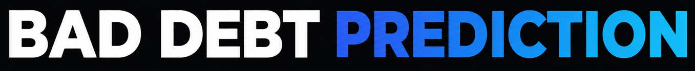
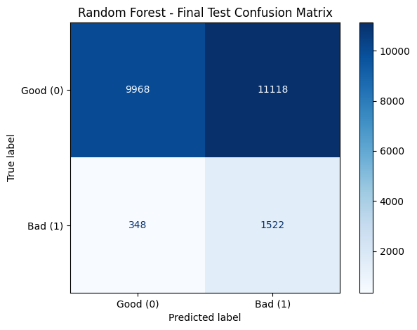
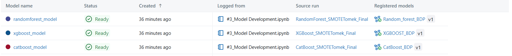

  

---

------

## Problem Statement

In a **Buy Now, Pay Later business**, understanding how likely a customer is to default on instalment payments is central to managing credit risk. Defaults create bad debt, financial losses and cash-flow pressure.

This project set out to build a **machine learning-based Bad Debt Prediction** system that flags customers with a higher likelihood of default. It draws on customer details, loan information, credit bureau data and payment history to classify customers as **Good Debt or Bad Debt**, helping the business make better-informed lending decisions.

## 1. Data Profiling and Preparation

I began by exploring roughly **110,000 records across 99 features**, covering customer details, loan information, credit bureau attributes and payment history. Data quality was checked for missing values, duplicates, data types and invalid entries. The initial cleaning removed **3,644 duplicate records**.

Some features showed **30–40% missingness**. I examined the patterns behind these gaps and kept them where they carried meaning, rather than filling them in by default. Lending-related features were also reviewed to understand their characteristics and their relevance to default prediction.

The customer, loan, credit bureau and supplementary datasets were then merged using customer identifiers. This excluded **12,611** unmatched customer IDs, and a further **1,896 unmatched records** were removed during validation. The resulting Credit Risk Master Table held **91,849** records and **99** features, and formed the basis for all later analysis and modelling.

## 2. Exploratory Data Analysis (EDA)

The OUTCOME variable showed clear class imbalance, with about **92% of customers classed as Good Debt and 8%** as Bad Debt. Numerical and categorical features were examined through descriptive statistics, histograms, boxplots and frequency distributions to understand their patterns.

CR21 and CR22 credit bureau features were compared across the two customer groups, and several CR22 features showed a clearer difference in medians. Repayment patterns, previous defaults and delinquency indicators were also reviewed to see how payment behaviour differed between Good Debt and Bad Debt customers.

**Outliers** were assessed using the Interquartile Range (IQR) method. The highest outlier percentages appeared in **CLOSED_ACCT_CR22 (24.11%), CREDIT_CARD_AMT_CR22 (21.22%) and Cumulative_Delinquency_Exposure (17.93%)**. Because many of these were genuine high-value observations, I retained them rather than removing them on statistical grounds alone.

Features were selected based on statistical findings, observed behaviour and relevance to default prediction. They were grouped into four categories: Credit Risk, Payment Behaviour, Credit Exposure and Customer Profile.

## 3. Model Development

After splitting the dataset into training, validation and test sets, SMOTE-Tomek was applied only to the training data to address class imbalance. The validation and test sets were kept unchanged to ensure a fair evaluation of model performance.

Three machine learning models were developed: Random Forest, XGBoost and CatBoost. For each model, the classification threshold was selected using validation data before evaluating the final performance on the test set.

| **Model**     | **Bad Debt Recall** | **Threshold** | **ROC-AUC** | **Precision** |
| ------------- | ------------------: | ------------: | ----------: | ------------: |
| Random Forest |              81.39% |          0.26 |      0.7377 |        12.04% |
| XGBoost       |              74.49% |          0.10 |      0.6892 |        11.40% |
| CatBoost      |              85.08% |          0.09 |      0.7208 |        11.51% |

#### Selected Model: Random Forest

Random Forest was selected as the final model after comparing the results of all three algorithms.

Compared with XGBoost, Random Forest achieved higher Bad Debt recall (81.39% against 74.49%) and a higher ROC-AUC (0.7377 against 0.6892). This indicates that it identified more actual Bad Debt cases and performed better at distinguishing between Good Debt and Bad Debt customers.

CatBoost achieved the highest Bad Debt recall at 85.08%. However, Random Forest recorded a slightly higher ROC-AUC of 0.7377 compared with 0.7208 for CatBoost. CatBoost also showed a larger gap between training and validation performance, suggesting potential overfitting.

Based on these results, Random Forest was chosen because it offered a better overall balance between identifying Bad Debt cases, distinguishing between the two classes and generalising to unseen data.

On the final test set, Random Forest achieved **81.39% Bad Debt recall, 12.04% precision, 20.98% F1-score, 0.7377 ROC-AUC and 0.2620 PR-AUC**, using a classification threshold of 0.26.

The five most influential features identified were `RISK_SCORE`, `SCORE_CR22`, `NO_ADDRESS_AT_MONTHS`, `OPEN_ACCT_CR22` and `CLOSED_ACCT_CR22`.

        

#### MLflow Experiment Tracking and Model Registry

MLflow was used to record and compare the experiments conducted with Random Forest, XGBoost and CatBoost. The model parameters, classification thresholds and test performance metrics were logged for each experiment. All three trained models were also registered in the MLflow Model Registry, with individual model versions maintained for tracking and future reference.

        

**Screenshots:**

1. MLflow Model Registry showing the three registered models and their versions.
2. MLflow experiment comparison showing Recall, ROC-AUC and Precision for all three models.
