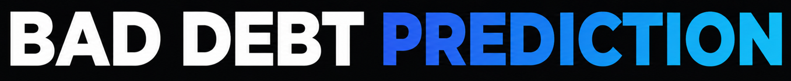
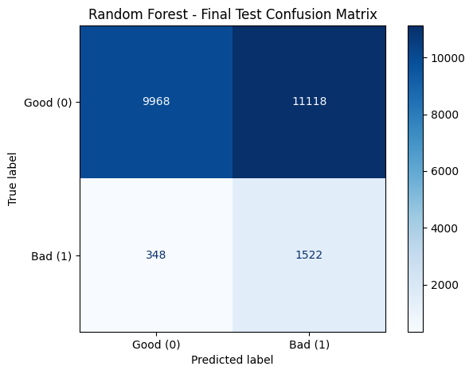
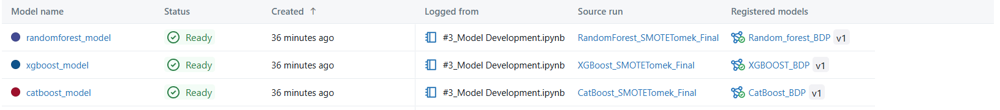

  

---

------

## 1. Problem Statement

Buy Now, Pay Later (BNPL) is a short-term financing model that allows customers to purchase products or services and repay the amount through scheduled instalments. While this provides flexibility to customers, defaults on instalment payments can create bad debt, financial losses and cash-flow challenges for BNPL businesses. Therefore, understanding customer creditworthiness and repayment behaviour is important for managing credit risk.

This project focuses on developing a **machine learning-based Bad Debt Prediction system** to identify customers who are more likely to default on their instalment payments. It uses customer details, loan information, credit bureau data and payment history to classify customers as **Good Debt or Bad Debt**, supporting better-informed lending decisions.

The primary objective is to **minimise potential financial losses caused by customer defaults** by identifying as many high-risk customers as possible before lending decisions are made. Accordingly, the project prioritises **high Bad Debt recall** to reduce the number of actual defaulters missed by the model while supporting risk-based customer assessment.

## 2. Dataset Description

The project uses multiple datasets containing approximately **110,000 initial records and 99 features**, covering four major information categories.

| Dataset Category | Description |
|---|---|
| Customer Data | Customer profiles and personal information. |
| Loan Data | Loan details, amounts and repayment-related information. |
| Credit Bureau Data | Credit scores, credit enquiries, account history and outstanding credit exposure. |
| Payment History Data | Previous repayments, defaults and delinquency behaviour. |

These datasets were integrated using customer identifiers to create a unified Credit Risk Master Table containing **91,849 records and 99 features**.

**Target Variable:** `OUTCOME`

- **Good Debt:** Customers classified as non-defaulters.
- **Bad Debt:** Customers classified as defaulters.

---

## 1. Data Profiling and Preparation

I started by exploring approximately **110,000 records with 99 features**, covering customer details, loan information, credit bureau data and payment history. The initial analysis focused on understanding the data quality, including missing values, duplicate records, data types and invalid entries. During this process, **3,644 duplicate records** were identified and removed.

Some features had a considerable amount of missing data, with missing values ranging from **30–40%** in certain columns. Rather than removing all such features or filling missing values blindly, I examined their patterns and retained those that still provided useful information for credit risk assessment.

However, six features — `WORST_1M`, `WORST_3M`, `WORST_6M`, `WORST_12M`, `WORST_18M` and `WORST_24M` — had approximately **90% missing values** and offered limited additional information. I decided to remove them from the analysis.

I also excluded `SCORE_INDICATOR_CR22` after observing a non-monotonic relationship with default risk, where higher scores were associated with higher default rates. Since this behaviour was difficult to interpret from a credit risk perspective and raised concerns about the feature's reliability, I decided not to include it in the modelling process.

Collection-related variables, including `AGENCY_AMT` and `MTH_TILL_AGENCY`, were also reviewed as part of the feature assessment.

After the initial cleaning and feature assessment, the customer, loan, credit bureau and supplementary datasets were merged using customer identifiers. This resulted in **12,611 unmatched customer IDs** being excluded, followed by the removal of another **1,896 unmatched records** during validation.

After these steps, the consolidated Credit Risk Master Table contained **91,849 records and 89 features**. This dataset was then used for the subsequent exploratory data analysis and model development.

## 2. Exploratory Data Analysis (EDA)

The OUTCOME variable showed clear class imbalance, with about **92% of customers classed as Good Debt and 8%** as Bad Debt. Numerical and categorical features were examined through descriptive statistics, histograms, boxplots and frequency distributions to understand their patterns.

CR21 and CR22 credit bureau features were compared across the two customer groups, and several CR22 features showed a clearer difference in medians. Repayment patterns, previous defaults and delinquency indicators were also reviewed to see how payment behaviour differed between Good Debt and Bad Debt customers.

**Outliers** were assessed using the Interquartile Range (IQR) method. The highest outlier percentages appeared in **CLOSED_ACCT_CR22 (24.11%), CREDIT_CARD_AMT_CR22 (21.22%) and Cumulative_Delinquency_Exposure (17.93%)**. Because many of these were genuine high-value observations, I retained them rather than removing them on statistical grounds alone.

Features were selected based on statistical findings, observed behaviour and relevance to default prediction. They were grouped into four categories: Credit Risk, Payment Behaviour, Credit Exposure and Customer Profile.

## 3. Model Development

After splitting the dataset into training, validation and test sets, **SMOTE-Tomek was applied only to the training data** to address class imbalance. The validation and test sets were kept unchanged to ensure a fair evaluation of model performance.

Three machine learning models were developed: **Random Forest, XGBoost and CatBoost**. For each model, the classification threshold was selected using validation data before evaluating the final performance on the test set.

| **Model** | **Bad Debt Recall** | **Threshold** | **ROC-AUC** | **Precision** |
|---|---:|---:|---:|---:|
| **Random Forest** | **81.39%** | **0.26** | **0.7377** | **12.04%** |
| XGBoost | 74.49% | 0.10 | 0.6892 | 11.40% |
| CatBoost | 85.08% | 0.09 | 0.7208 | 11.51% |

#### Selected Model: Random Forest

Random Forest was selected as the final model after comparing the results of all three algorithms.

Compared with XGBoost, Random Forest achieved **higher Bad Debt recall (81.39% against 74.49%)** and a **higher ROC-AUC (0.7377 against 0.6892)**. This indicates that it identified more actual Bad Debt cases and performed better at distinguishing between Good Debt and Bad Debt customers.

CatBoost achieved the **highest Bad Debt recall at 85.08%**. However, Random Forest recorded a slightly higher **ROC-AUC of 0.7377 compared with 0.7208 for CatBoost**. CatBoost also showed a larger gap between training and validation performance, suggesting potential overfitting.

Based on these results, Random Forest was chosen because it offered a **better overall balance between identifying Bad Debt cases, distinguishing between the two classes and generalising to unseen data**.

On the final test set, Random Forest achieved **81.39% Bad Debt recall, 12.04% precision, 20.98% F1-score, 0.7377 ROC-AUC and 0.2620 PR-AUC**, using a classification threshold of 0.26.

The five most influential features identified were `RISK_SCORE`, `SCORE_CR22`, `NO_ADDRESS_AT_MONTHS`, `OPEN_ACCT_CR22` and `CLOSED_ACCT_CR22`.

  

  <em>Figure: Random Forest final test confusion matrix and business interpretation.</em>

#### MLflow Experiment Tracking and Model Registry

MLflow was used to record and compare experiments conducted with Random Forest, XGBoost and CatBoost. Model parameters, classification thresholds and test performance metrics were logged for each experiment. All three trained models were also registered in the MLflow Model Registry, with individual versions maintained for tracking and future reference.

**Registered Models*

  

  <em>Figure: MLflow Model Registry showing the three registered models and their versions.</em>

